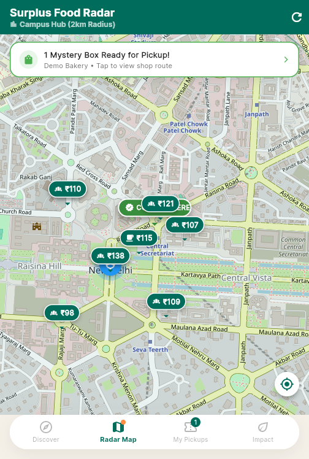
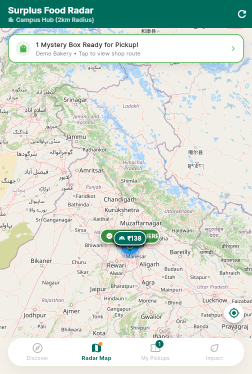
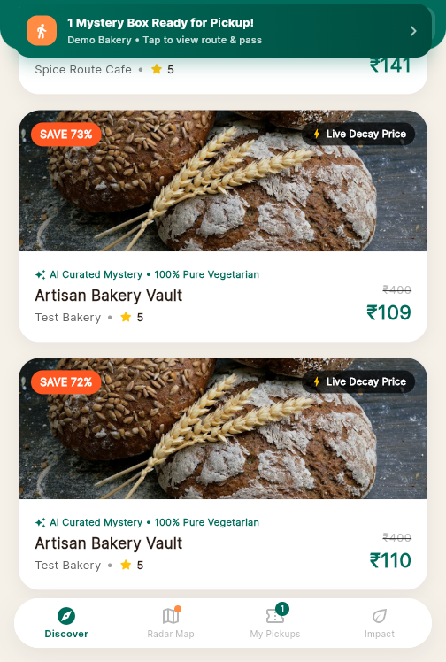

# SaveBite — Hyperlocal Surplus Food Marketplace

A mini project where local shops (bakeries, sweet shops, cafés) list their unsold food as
discounted **"Mystery Boxes"** with **live decay pricing** — the price drops as closing time
approaches. Students browse nearby deals on a radar map, reserve a box, pay, and collect it
in-store with a single-use pickup code.

| Role | Capabilities |
|------|-------------|
| **Student** | Sign up / sign in, discover deals on radar map + feed, reserve (5-min hold), pay with idempotent checkout, track order, pick up with a code |
| **Vendor** | Sign up with FSSAI license + shop location, list mystery boxes, watch live decay pricing, redeem student pickup codes |

## Tech Stack

- **Backend** — FastAPI, SQLAlchemy, GeoAlchemy2 (PostGIS), Redis, Pydantic
- **Mobile app** — Flutter (Material 3), runs on Android, iOS, macOS, Windows, Linux, and Web
- **Database** — PostgreSQL + PostGIS (Docker), Redis (Docker) for reservation holds & rate limits

## Repository Layout

```
backend/            FastAPI app
  main.py           App entry, auto-migrations, decay-pricing background job
  routers/          auth, deals, vendors, students, ai
  services/         decay_pricing.py, ai_vision_curator.py
  core/             config.py, security.py (token signing + password hashing)
  dependencies.py   Token-auth dependency used by every protected route
mobile_app/         Flutter app
  lib/screens/      onboarding, auth, student home/map/orders/checkout, vendor dashboard
  lib/services/     api_service, session_service, order_manager, deal_pricing
docker-compose.yml  PostgreSQL+PostGIS and Redis
```

## How to Run

You need **Docker Desktop**, **Python 3.11+**, and **Flutter 3.x** installed.

### 1. Start the databases

```bash
docker compose up -d
```

This starts `mystery_box_db` (PostGIS on `localhost:5432`, db `mysterybox`, user `password`)
and `mystery_box_redis` (Redis on `localhost:6379`).

### 2. Start the backend API

```bash
python -m venv .venv
# Windows:
.venv\Scripts\pip install -r backend/requirements.txt
.venv\Scripts\python -m uvicorn backend.main:app --host 127.0.0.1 --port 8000
# macOS/Linux:
#   python3 -m venv .venv && .venv/bin/pip install -r backend/requirements.txt
#   .venv/bin/python -m uvicorn backend.main:app --host 127.0.0.1 --port 8000
```

Tables and columns are **created automatically on startup** — no migration step needed.
Interactive API docs: <http://127.0.0.1:8000/docs>

Optional `.env` in the repo root (all have safe local defaults):

```
AUTH_SECRET_KEY=change-me-in-production
GEMINI_API_KEY=            # AI mystery-box descriptions (falls back to templates)
RAZORPAY_KEY_ID=           # real payments (test mode)
RAZORPAY_KEY_SECRET=
```

### 3. Start the Flutter app

```bash
cd mobile_app
flutter pub get
flutter run -d chrome --web-port 8081     # or: flutter run (Android emulator / device)
```

Production web build:

```bash
flutter build web --release
# output in mobile_app/build/web — serve with any static server
```

### 4. Seed a demo (first run)

1. **Register a vendor** — `POST /auth/register/vendor` with name, email, password, FSSAI
   license, shop category, and latitude/longitude.
2. **List a mystery box** — `POST /deals/create` with the vendor's token: original value,
   start price, minimum price, quantity, and closing time.
3. **Register a student** — `POST /auth/register/student`, then browse `GET /deals/active`,
   `POST /deals/reserve` (5-minute hold), and `POST /deals/orders/create` to pay and get a
   pickup code like `SB-C9B32RYT`.
4. **Vendor redeems** — `POST /deals/orders/verify-pickup` with the vendor token; the code
   is single-use and scoped to that store.

## Design Notes (correctness hardening)

- **Real auth** — PBKDF2-HMAC-SHA256 password hashing (200k iterations), HMAC-signed
  bearer tokens with expiry. Every protected route derives the user from the token, never
  from the request body.
- **No overselling** — orders take a `FOR UPDATE` row lock on the deal; concurrent buyers
  cannot take the last box.
- **No phantom sold-out** — reservations are Redis holds (`deal_locks:{id}`) with a 5-minute
  TTL, swept before every capacity check, so abandoned holds self-heal.
- **No double-charge** — order creation is idempotent via a client `client_request_id`;
  retries return the original order.
- **Strict pickup** — 8-char Crockford-base32 codes (~36 bits), single-use, redeeming store
  taken from the vendor token (a vendor cannot redeem another store's codes), and failed
  attempts rate-limited (5 per 300 s).
- **Timezone-correct** — all timestamps stored as `timestamptz` UTC, so countdowns render
  correctly in IST.

## Screenshots

| Order tracker with live API order | Radar map with decay-priced pin | Deal feed with live decay pricing |
|---|---|---|
|  |  |  |
