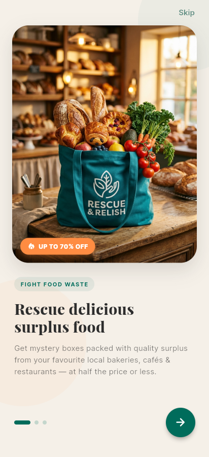
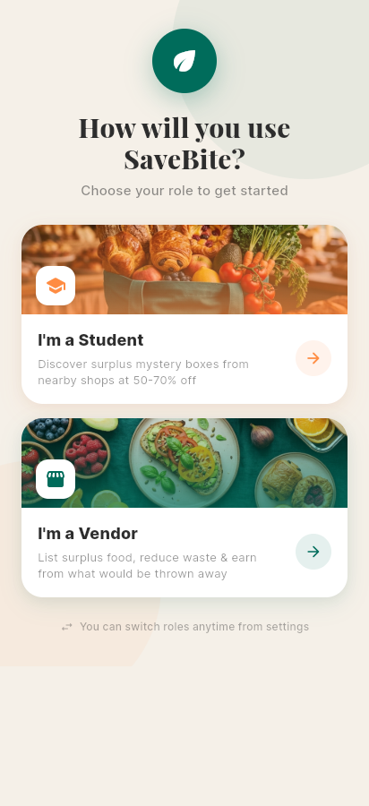
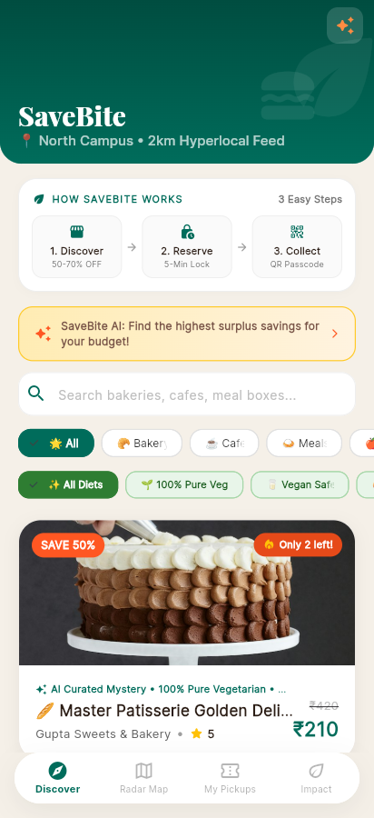
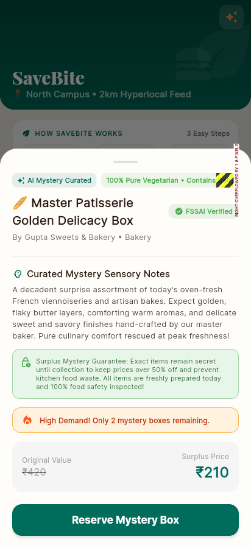
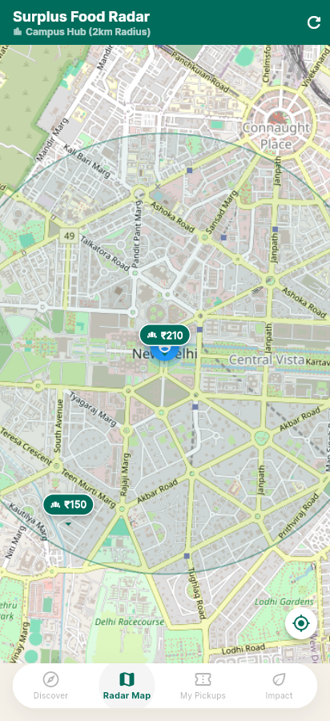
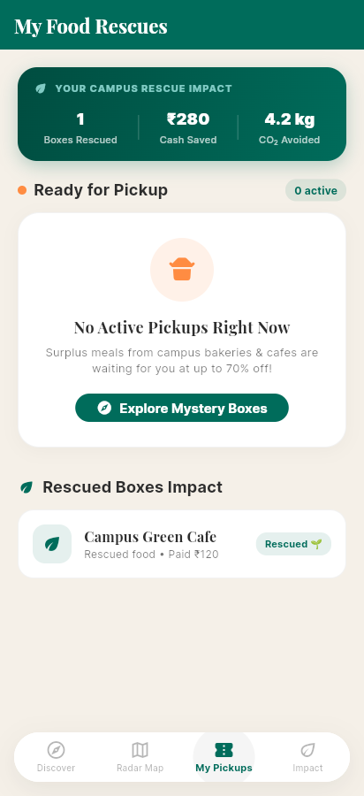
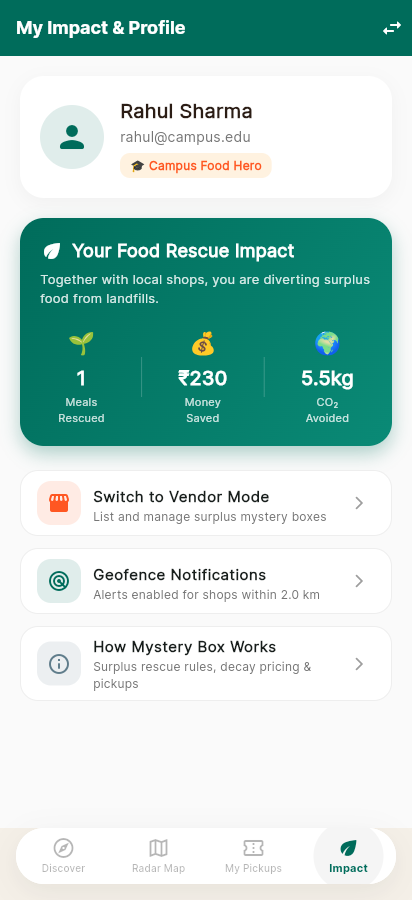
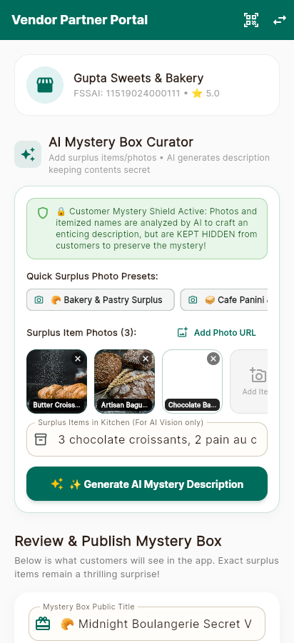

# SaveBite — Product & Technical Audit

**Date:** 19 October 2026
**Scope:** Flutter app (`mobile_app/`), FastAPI backend (`backend/`), design system (`replica/`), review-1 material
**Method:** Full read of the Flutter and FastAPI code, live run of Postgres/PostGIS + Redis + API + Flutter Web, endpoint probes, UI screenshots at a 412×900 phone viewport, and competitor/design research.

---

## 1. Verdict first

**The idea is clear and worth building.** SaveBite is a two-sided, hyperlocal surplus-food marketplace for Indian college campuses: vendors list time-boxed "mystery boxes" of unsold food at a large discount, students discover them within walking distance, reserve with a short inventory lock, pay, and collect with a verifiable pickup code. The differentiators you want are (a) campus-first hyperlocality, (b) live price decay, (c) AI that reduces the "surprise bag gamble", and (d) India-grade trust (FSSAI, veg/non-veg, packed-at, consume-by).

**The current app is a strong demo shell around a hollow core.** The visual identity is genuinely good — warm cream, deep teal, Playfair display headings, OSM map, phone-frame presentation. But the marketplace loop is not real yet: there is no user identity, orders live only in memory, the app never reads orders back from the server, "AI" is mostly random templates, prices shown are not the decayed prices charged, and the pickup code can be bypassed. Those are the things to fix before adding more screens.

**Stack verdict: stay on Flutter.** Flutter is not what is limiting the UI/UX. The code compiles cleanly (`flutter analyze`: 0 errors, 10 infos), the screens render well, and `flutter_map` + OSRM already give you a zero-cost map stack. A rewrite to React Native/Expo would consume the remaining project runway and produce no visible improvement for Review 2. Fix the architecture, add a real design system and motion, and keep Flutter.

---

## 2. What actually exists

| Layer | Reality |
|---|---|
| Flutter UI | 14 Dart files, ~7,184 lines. Onboarding, role selection, student shell (Discover / Radar Map / Pickups / Impact), deal sheet, checkout, vendor portal. Material 3, `google_fonts`, `provider` (barely used), `flutter_map`, `geolocator`, `http`. |
| Backend | FastAPI + SQLAlchemy + GeoAlchemy2 + PostGIS + Redis. Vendors, deals, reservation locks, orders, pickup verification, students, heuristic "AI" endpoints, decay pricing job. |
| Data | Postgres/PostGIS and Redis are running via `docker-compose.yml`. 4 vendors and 11 deals remain in the dev DB. Only 1 deal was active at the start of the audit. |
| Tests | **None.** No `mobile_app/test/`, no backend test directory, no CI. |
| Auth | `/auth/login` returns a hardcoded `dummy_token_123` for any non-empty email + password. The app never calls it. Student and vendor IDs are hardcoded (`1`). |
| Payments | Simulated. Razorpay is in `requirements.txt` but never called. |
| Notifications | `notifications.py` only prints a mock FCM payload. No device tokens are stored. |
| Design | Coherent tokens in `replica/design/tokens.json` and `main.dart`; a 17-screen recon of Too Good To Go in `replica/recon.md`. |

### Verified live, not assumed

- API boots and serves `GET /` and `GET /deals/active`.
- Flutter Web compiles and serves; screenshots captured at 412×900.
- Reservation lock works across students (3 succeeded, 4th got HTTP 409).
- `POST /deals/orders/create` accepts a student that does not exist → HTTP 500.
- The same student can create **two PAID orders for the same deal** (no idempotency, no lock check).
- Abandoned reservations leave `deal_inventory:<id> = 0` while the DB still has stock, until the deal closes.
- UI overflow stripes visible in onboarding (desktop frame) and in the deal detail sheet (45 px).

---

## 3. Current UI, as rendered

| Onboarding | Role selection | Discover |
|---|---|---|
|  |  |  |

| Deal detail | Radar map | Pickups |
|---|---|---|
|  |  |  |

| Impact | Vendor portal |
|---|---|
|  |  |

**What already feels premium:** cream/teal palette, serif display type, rounded photography, "Only 2 left" scarcity chip, AI narrative block, bottom-sheet detail, the map, and the vendor "AI curator" card.

**What breaks the illusion:** a yellow/black overflow stripe in the deal sheet, a pre-seeded "Campus Green Cafe" order from nowhere, "Rahul Sharma / rahul@campus.edu" as a fixed identity, inconsistent CO₂ numbers (4.2 kg on Pickups vs 5.5 kg on Impact for the same single rescue), static prices that contradict "prices drop every minute", and no pickup window/distance on the deal card — the two facts a real buyer needs most.

---

## 4. Defects that matter (ranked)

### P0 — the core loop is not trustworthy

| # | Defect | Evidence | Fix |
|---|---|---|---|
| 1 | **No identity.** Every student action sends `student_id: 1`; profile is hardcoded. | `student_home.dart:1009`, `checkout.dart:119,138`, `student_map.dart:125`, `student_profile.dart:67` | Phone OTP (Firebase Auth) or email+password with JWT. Persist the token in `flutter_secure_storage`. Never send a client-supplied student id. |
| 2 | **Orders are memory-only.** They disappear on restart; the backend endpoint `/deals/orders/student/{id}` is never called. A seeded fake order is injected to make the screen look populated. | `order_manager.dart:38-58`; no `getStudentOrders` in `api_service.dart` | Fetch orders from the API on app start and after each mutation. Delete the seed. |
| 3 | **Order creation bypasses the reservation.** `createOrder` only checks `deal.quantity > 0`; it never checks the Redis lock or that the caller reserved. | `backend/routers/deals.py:169-215` | Require a reservation token/lock for the same deal + user; reject otherwise. Make the order endpoint idempotent with a client request id. |
| 4 | **Double ordering.** Same user, same deal, two orders → stock decremented twice. | Reproduced: orders `MB-49-3652` and `MB-49-7771`, quantity 3 → 1 | Unique constraint on `(deal_id, student_id, status)` for active orders + transaction + row lock (`SELECT … FOR UPDATE`). |
| 5 | **Phantom sold-out.** Reservations decrement Redis, but an abandoned reservation never returns stock, and the inventory key TTL is the deal's closing time, not 5 minutes. | `deals.py:138` sets TTL to closing time; verified `deal_inventory:49 = 0` with DB quantity 1 | Decrement inside a DB transaction; let the 5-minute lock expiry restore inventory; or drop Redis inventory and use `SELECT … FOR UPDATE`. |
| 6 | **Student can mark their own pickup.** "Yes, Collected" calls `/deals/{id}/complete`, which decrements stock again without a pickup code. | `student_orders.dart:82`, `deals.py:343-360` | Only the vendor verification endpoint may set `COLLECTED`. Student action should be "show code", not "complete". |
| 7 | **Pickup code is weak and unlimited.** `MB-<deal>-<4 digits>` = 10,000 guesses per deal, no rate limit, and the vendor ID is hardcoded to 1. | `deals.py:184-186`; `vendor_dashboard.dart:431` | 6-8 char code or signed QR, rate-limit attempts, verify against the authenticated vendor, one-time use. |
| 8 | **Timezone is wrong by 5.5 hours.** `closing_time` is stored as `timestamp without time zone`; the API returns a naive ISO string; Flutter parses it as local time. | DB `\d deals` shows `timestamp without time zone`; `checkout.dart:109`, `deals.py:234` | Migrate to `timestamptz`, always return UTC with `Z`, parse with `DateTime.parse(...).toLocal()`. Add a test. |
| 9 | **Displayed price ≠ charged price.** Cards/map/show use `start_price`; the backend charges `calculate_decay_price`. During the audit the card said ₹210 while the server charged ₹149.98. | `student_home.dart:458,1047`, `student_map.dart:430,649` | Add `current_price` to the API response and render only that. Show "was ₹420 → now ₹150" with a live refresh. |
| 10 | **Cross-store pickup accepted/blocked incorrectly.** Verification checks `order.vendor_id != request.vendor_id`, but the app always sends vendor 1, so a student at another store fails verification. | `vendor_dashboard.dart:431` | Real vendor session; QR contains order id + signature. |

### P1 — demo credibility

| # | Defect | Evidence |
|---|---|---|
| 11 | "AI" is a random template unless `GEMINI_API_KEY` is set. Category templates pick random titles/descriptions; the "vision" endpoint never receives an image from Flutter. | `ai_vision_curator.py:51-61`; vendor UI sends text only |
| 12 | "AI recommendation" is a linear scoring formula with a canned paragraph. Calling it an agent/LLM in the viva will not survive a question. | `backend/routers/ai.py:42-130` |
| 13 | Impact numbers disagree and are partly invented (`savings*0.015 + meals*2.1` in one place, `savings*0.015` in another). | `order_manager.dart:76` vs `student_orders.dart:707` |
| 14 | Vendor dashboard uses fixed photos, sample trays and vendor 1; there is no live order feed or revenue. | `vendor_dashboard.dart:32,48,258` |
| 15 | Favourites, ratings persistence, order cancellation, missed-pickup handling and refunds are advertised in the recon but absent. Rating dialog is UI-only. | `student_orders.dart` rating dialog has no API call |
| 16 | No distance sort or 2 km filter on `GET /deals/active`; "2 km hyperlocal" is a UI label. | `deals.py:70-95` |
| 17 | The phone-frame wrapper runs in production builds and breaks at short desktop heights (45 px overflow). | `main.dart` builder; `mobile_frame_wrapper.dart` |
| 18 | Backend price job crashes every run on Windows because it prints `₹` to a cp1252 console. Prices are computed on demand, so this is noise, but it hides real errors. | `decay_pricing.py` print; live log |
| 19 | CORS is `*`, no rate limiting, no input limits on reservation endpoints. | `main.py:62-64` |
| 20 | No tests and no seed script. A fresh clone cannot reproduce the demo data. | repo |

### P2 — product polish
Dark mode, accessibility semantics, skeleton loaders, empty/error states, offline caching, image upload/compression, map clustering, deep links, share pass, analytics, referral, campus waitlist.

---

## 5. Stack decision: Flutter vs React Native vs PWA

**Recommendation: keep Flutter for the app. Do not rewrite.**

| Criterion | Flutter (current) | React Native / Expo | PWA |
|---|---|---|---|
| Custom visual identity & motion | **Best** — full control of every pixel; implicit animations, physics, shared-element transitions | Good, but needs Reanimated for equivalent polish | Good, but browser inconsistencies |
| Existing code | **7k lines already working** | Full rewrite (3-6 weeks for this team) | Rewrite of UI shell |
| Maps | `flutter_map` + OSM = zero cost, already working | `react-native-maps` (small maintainer team) or paid Google Maps | Web map, weaker native feel |
| Camera / AI | `camera` + server-side Gemini; `firebase_ai` exists for Flutter | Expo Camera is excellent; VisionCamera for frame processing | Web camera works, less reliable |
| Push | FCM via `firebase_messaging` | Expo push is simpler | iOS requires install-to-home-screen |
| Team fit | Already shipping Dart | Better only if the team is already React-native | Best for a web landing/vendor portal |
| Time to Review 2 | **Shortest** | Longest | Medium |

**Why Flutter is not your UI/UX problem:** the screenshots show a coherent, modern app. The gaps are information architecture (no pickup window/distance on cards), state (fake orders), feedback (overflow, static prices), and content (Unsplash imagery, template copy). None of those change with a framework.

**When switching would be rational:** the whole team is already fluent in React/TypeScript and wants one codebase for a web vendor portal; or you need advanced AR/real-time camera segmentation that Flutter plugins cannot support. Neither is true today.

**Practical architecture to keep Flutter healthy:**
- `feature-first` folders (`features/discover`, `features/checkout`, `features/orders`, `features/vendor`), not 1,400-line screens.
- **Riverpod** for state (replace the singleton `OrderManager`), **go_router** for navigation and deep links, **dio** + interceptors for auth/retries, **freezed/json_serializable** for models.
- One `design_system/` package: tokens, typography, spacing, buttons, chips, sheets. Remove colour literals from screens (there are dozens of `Color(0xFF006C5B)` copies).
- `flutter_secure_storage` for tokens; `shared_preferences`/Drift for cache.
- Widget/golden tests for the design system; integration test for reserve → pay → verify.
- Build flavors (`dev`, `prod`) with `--dart-define=API_BASE_URL=...`; never hardcode localhost.
- Keep the phone frame behind a `--dart-define=DEMO_FRAME=true` flag, never in release.

---

## 6. Competitive read (October 2026)

| | Too Good To Go | Plenti (India) | Good To Grab (India) |
|---|---|---|---|
| Model | Surprise Bag at ~1/3 retail, partner fee | "Surprise Drops" at ~1/3 price, pickup only | Flat 50% off surplus meals |
| Presence | Huge globally; **not operating in India** in the sources reviewed | Kerala: Thiruvananthapuram (Oct 2025) → Kochi (Mar 2026); reported 400+ vendors, 100k+ users | Hyderabad |
| Payment / pickup | Pay in app; staff confirms with swipe | Pay in app; show in-app code | Reserve + pickup; payment/verification details unclear |
| Trust features | Allergen/dietary filters, pickup window, receipts | Packed time, veg/non-veg, consume-by sticker | Limited |
| Ratings | 4.9 (UK Play, ~2M reviews) | 4.7 (1.24k reviews, 100k+ downloads) | 4.2 (407 reviews, 50k+ downloads) |
| Recurring complaints | Stale/mouldy items, vague contents, cancelled pickups, slow refunds | Supply gaps, added fees, no delivery | Very late pickups, limited selection, support gaps |

**What that means for SaveBite:**
1. **TGTG's playbook is validated but absent here.** Copy the loop, not the brand: surprise bag, pickup window, swipe/code handoff, favourites, strict cancellation.
2. **Plenti proves India willingness to pay** at ~1/3 price. It also shows the ceiling: city-by-city supply, not demand, is the constraint. Campus-first solves cold start: one campus = dozens of vendors within 2 km and thousands of students.
3. **The unsolved trust gap is your wedge.** Plenti's packed-at/consume-by sticker is the right instinct. Make it digital and verifiable: FSSAI licence, veg/non-veg, packed-at, consume-by, allergen flags, vendor rating, photo of the actual box (not stock imagery).
4. **"AI" alone is not a moat.** Everyone can call Gemini. The defensible AI is vendor-side demand forecasting and auto-pricing from real campus sell-through data — it makes supply appear and reduces waste, which is the hard side of the marketplace.
5. **Reliability is the retention feature.** Pickup cancellations are the #1 complaint globally. Make vendor acknowledgment, live "ready" status, and automatic refunds part of v1, not v2.

### Positioning statement
> For Indian college students who want a real meal at half price without gambling on unknown food, **SaveBite** is the campus-only surplus marketplace that shows exactly when food was packed, what it contains (veg/non-veg, allergens), and a price that falls as closing time approaches — from vendors within a 10-minute walk.

---

## 7. UI/UX direction

You already have a good base. Make it a system, then add a few signature moments.

**Tokens to formalise** (from the existing palette):
- Canvas `#F5F0E8`, surface `#FFFDF9`, warm panel `#EDE6DA`, ink `#2B1D15`, muted `#6B5D52`, border `#D4C9B8`.
- Primary `#006C5B`, primary dark `#005A4B`, subtle `#E6F2EF`; accent `#FF8C42`; danger `#D94040`; success `#2E7D32`.
- Radius: 14 inputs, 20 chips, 24 cards, 28 sheets. Spacing: 4/8/12/16/24/32. Minimum tap target 48×48.
- Type: Playfair Display for brand/headlines, Inter (or a variable sans) for UI, tabular numerals for prices and countdowns.

**Screen-level changes that will read as "modern" immediately:**
1. **Deal card**: photo, vendor, distance (e.g. "450 m · 6 min walk"), pickup window ("Today 7:00–9:00 PM"), live price with struck-through original, `n left` chip, dietary/veg dot. This is the single highest-impact UI change.
2. **Live price**: a subtle price ticker with "drops to ₹120 by 9 PM" and a progress rail. This makes your differentiator visible instead of a claim.
3. **Pickup pass**: a full-screen ticket with a large code/QR, vendor address, map thumbnail, "I'm on my way" and a live window countdown. After handoff, a receipt that shows ₹ saved and kg CO₂ avoided — one consistent formula.
4. **Vendor "magic listing"**: photo → AI detects items/allergens → vendor confirms → auto title, dietary tag, suggested price band and quantity. Show the AI's confidence and let the vendor edit. This is a 30-second listing flow, which is what supply needs.
5. **Impact**: one receipt-style card ("You rescued 3 meals · ₹640 saved · 6.3 kg CO₂e"), with a shareable story card. Remove the gamified hero badge until it is earned.
6. **Motion**: 180–240 ms ease-out transitions, spring on card press, haptic on reserve, animated count on impact. Respect reduced-motion. Keep the phone-frame wrapper for the review demo only.
7. **Accessibility**: semantic labels on price/stock/countdown, 4.5:1 contrast on muted text, large-text layout checks, no colour-only status.
8. **Trust block** on store detail: FSSAI number, rating, "packed at", "consume by", allergen chips, and a real photo. Replace all stock Unsplash covers with vendor photos as soon as upload exists.

**Brand**: keep "SaveBite" and the Rescue & Relish tote motif. Use the warm paper aesthetic for discovery and a crisper, receipt-like style for pickup passes — the contrast makes the transactional moment feel official. The Rapida Dribbble reference was not machine-readable during research, so do not claim to have copied it; use its general direction (bold type, saturated accent, delivery-forward composition) only after a human looks at it.

---

## 8. AI strategy — make it real, narrow, and cheap

Do not ship three half-real AI features. Ship one that customers feel and one that vendors need.

**A. Real vision curation (vendor side)** — Gemini Flash via server, key in env, never in the app.
- Input: up to 3 vendor photos + optional text.
- Output schema: detected items (private), allergens, veg/non-veg/Jain, freshness window, a 2-sentence mystery description, suggested price band.
- Guardrail: never reveal itemized contents to customers; show "AI-curated · vendor-confirmed" and let the vendor edit.
- Cost control: only on listing creation, cache per image hash, cap per vendor per day, fall back to the existing template if quota/error. No per-scroll calls.

**B. Demand-aware auto-pricing (vendor side, the real moat)** — deterministic and free.
- Inputs: campus calendar, weekday, weather, historical sell-through at this vendor, remaining quantity, time to close.
- Output: suggested quantity + start/min price; then the live decay curve.
- This is genuinely useful and defensible, and it costs nothing per request when run as a nightly job.

**C. Personal ranking (student side)** — start with rules (distance, dietary, budget, time), then learn from clicks/orders. Show a one-line "why" ("closest pure-veg bakery under ₹150, closes in 40 min"). Do not call an LLM on the home screen.

**D. Support copilot (later)** — vendor FAQ + order issues, retrieval over your own policy docs.

**Budget/limits:** Gemini Flash's free tier can cover a campus pilot; verify current quota, then add a hard monthly cap, request timeout, retry with backoff, and graceful fallback. Never put the key in Flutter. Do not call Google Places/paid maps: `flutter_map` + OSM + OSRM already cover discovery and walking routes at zero marginal cost. For any public API from `public-apis`, check licence, quota and whether it needs a credit card before wiring it in.

---

## 9. Roadmap

### Sprint 1 (3–4 days) — make the loop true
1. Auth: student phone/email login, JWT, persisted session; vendor login tied to a vendor row. Remove every `studentId: 1` and `vendorId: 1`.
2. Orders: fetch from API, remove the seeded order, show real active/completed tabs.
3. Inventory: one transactional reservation → order path; idempotency key; restore stock on expiry; row-level lock; no double decrement.
4. Pickup: vendor-only verification, 6+ char code/QR, rate limit, one-time use.
5. Time: `timestamptz`, UTC ISO with `Z`, tests; consistent countdown.
6. Price: return and render `current_price` everywhere; show the decay rail.
7. Delete demo fallbacks or gate them behind `DEMO_MODE`.

### Sprint 2 (1 week) — trust and retention
Razorpay test-mode UPI, refund on cancellation, FCM device tokens, favourites, persisted ratings, vendor live order feed, "ready for pickup" status, missed-pickup auto-cancel, image upload + compression, FSSAI/packed-at/consume-by fields, real seed script with 5 campus vendors.

### Sprint 3 (1 week) — differentiation
Real Gemini vision listing flow, vendor auto-price/quantity suggestion, student ranking with "why", impact receipt + share card, map clustering and distance sort, skeleton/empty/error states, accessibility pass.

### Sprint 4 — launch readiness
Integration tests for the full loop, load test the last-box race (50 concurrent reserves), analytics funnel, crash reporting, privacy policy, store listing, campus ambassador onboarding.

---

## 10. What "done" looks like for Review 2

A judge should be able to:
1. Sign up as a student on one phone and as a vendor on another.
2. See only real vendors within 2 km, with distance, pickup window and the live price.
3. Watch the price fall as closing time approaches.
4. Reserve the last box; a second student gets a clean "sold out", not an error.
5. Pay in test mode and receive a pickup pass with a QR/code.
6. Have the vendor scan/enter the code; the order flips to collected exactly once for both sides.
7. Restart the app and still see the order.
8. See one consistent impact number and a real vendor photo.
9. Hear an honest AI story: one real vision feature and one real forecasting feature, with costs and fallbacks.

That is a demonstrably real marketplace, not a mockup — and it is achievable on the current Flutter + FastAPI stack.

---

## 11. Skills installed and used

- **agent-browser** — installed globally (`agent-browser 0.39.1` + Chrome 155) and used to drive the Flutter Web build at a 412×900 viewport for the screenshots above.
- **replica-skill / replica-recon / replica-design** — already vendored in `.agents/skills/`; `replica/recon.md`, `features.csv` and `design/components.md` informed the screen and component analysis.
- **brainstorming** — applied as the analysis/approval gate: no product code was changed in this pass.
- **web-design-guidelines** — used as the accessibility/UI review checklist.
- **mirofish** (review/QA) and **rea** are vendored but not started; they need their own Docker/LLM setup.
- `react`, `react-native` and `create-react-app` are frameworks, not skills; cloning them would add hundreds of MB without helping this project, so they were not installed. `public-apis` is a catalogue, not a skill — it is useful only with quota/cost checks.
